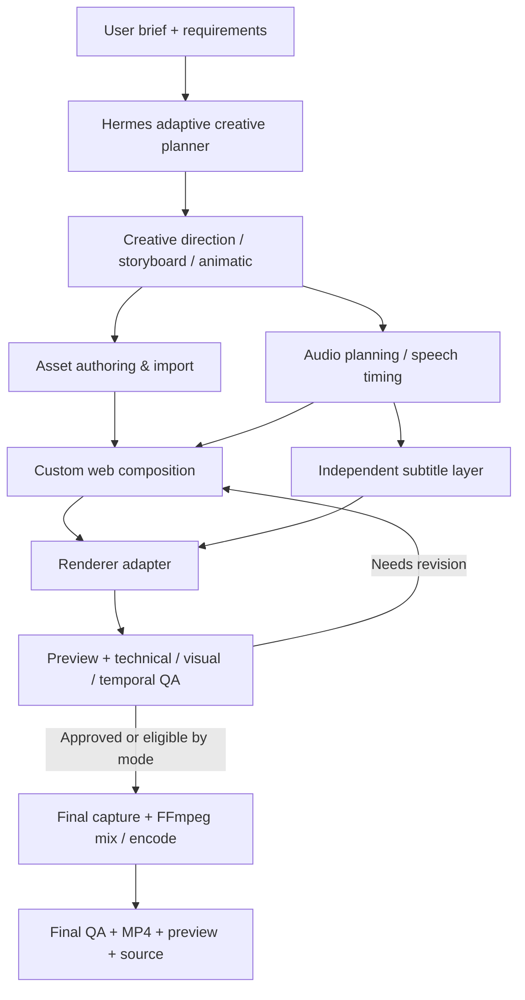

# UMP v2.0 — Master Blueprint & Implementation Directive

**Status:** baseline desain disepakati operator; implementasi belum dimulai oleh penyusun blueprint.

**Tanggal:** 25 November 2026

**Repository:** https://github.com/kannnnna9/ultimate-motion-workflow

**Baseline audit:** v1.6.2, `main`, commit `c98abae30ef729ddc77c00911878d108986d9b0f` (23 November 2026).

**Implementer:** Hermes Agent. **Product owner:** operator UMP.

**Lingkungan target awal:** Hermes pada VM LightVela, https://lightvela.ai/. Spesifikasi aktual dan kemampuan GPU harus diprofil oleh Hermes, bukan diasumsikan dari nama paket.

---

## 0. Instruksi pembuka untuk Hermes

Dokumen ini mengonsolidasikan keputusan operator dan diskusi arsitektur UMP v2.0. Gunakan sebagai sumber kebenaran desain, bukan sebagai patch yang sudah diuji. Tinjau source code aktual, dokumentasi, konfigurasi deployment dan data lokal sebelum melakukan perubahan. Jika HEAD sudah berbeda dari baseline audit, catat commit terbaru dan sesuaikan rencana. Jangan downgrade atau menghapus pekerjaan yang lebih baru.

**Tujuan pekerjaan adalah menghasilkan video yang lebih baik, bukan sekadar framework yang lebih besar.** Jangan menambah abstraksi, schema, agent, preset, atau dependency tanpa kebutuhan yang terbukti. Implementasikan kemampuan inti terlebih dahulu, demonstrasikan dengan video nyata, lalu perluas.

Aturan eksekusi:

1. Inventarisasi dan backup data yang relevan. Pisahkan pengembangan dari instalasi produksi. Gunakan branch pengembangan v2 dan working data terisolasi; jangan overwrite main, instalasi aktif, atau data operator secara diam-diam.
2. Jalankan baseline test, audit ulang temuan di bawah, catat kegagalan yang sudah ada, ukur kemampuan VM dan tulis implementation plan singkat dengan milestone serta acceptance criteria.
3. Implementasikan secara incremental, commit terfokus, jalankan pengujian dan render bukti nyata pada setiap milestone yang relevan. Jangan menganggap pekerjaan selesai karena test unit hijau.
4. Gunakan referensi sesuai fungsi masing-masing; baca source pada commit yang dipatok. Jangan sekadar menduplikasi dokumentasi atau menyalin demo menjadi template baru.
5. Jika diperlukan perubahan keputusan arsitektur, perubahan persyaratan terkunci, penggunaan layanan berbayar, migrasi destruktif atau downgrade kualitas yang telah disepakati, laporkan dan minta persetujuan operator. Detail teknis yang tidak mengubah kontrak boleh ditentukan Hermes berdasarkan pengujian.
6. Jangan mengklaim melihat video, berhasil menjalankan test, atau menyelesaikan fitur tanpa bukti. Laporkan keterbatasan model, hardware, akses aset, dan hasil pengujian apa adanya.

Tidak ada perintah untuk publish release, merge ke main, atau mengganti instalasi produksi tanpa approval operator. Persetujuan blueprint bukan persetujuan otomatis atas setiap tindakan deployment.

## 1. Product vision

**Ultimate Motion Workflow adalah AI-driven, adaptive, web-native, mobile-first creative video production framework.** Bukan explainer generator, bukan text-to-slide pipeline, dan bukan koleksi template video.

UMP menyediakan infrastruktur, alat, skill, referensi, kontrol kualitas dan rendering. Hermes menentukan konsep, mendesain aset, menyusun shot, menulis kode animasi original, mengatur audio, mengkritik hasil, dan merevisi pekerjaan sesuai brief.

Target output: video vertikal **9:16**, default **1080 × 1920, 30 FPS**, dengan 60 FPS opsional berdasarkan kebutuhan dan kemampuan mesin. Output utama MP4, disertai source composition dan web preview yang dapat diputar serta di-seek. Preview MP4 ringan untuk review dari ponsel/Telegram tetap berguna.

Jenis video yang perlu dimungkinkan: explainer, cerita pendek, anime opening, cinematic montage, commercial, trailer, kinetic typography, music visualizer, experimental art, 2D, 2.5D dan 3D programatik. Daftar ini contoh, bukan enum yang membatasi ide baru. Series merupakan arah produk jangka panjang; sistem kontinuitas lintas episode secara khusus ditunda dari release awal.

### Prinsip non-negotiable

- Creative-first, video-first, mobile-first; visual dapat menyampaikan makna tanpa bergantung pada teks.
- Style adalah bahasa artistik, bukan layout atau isi scene yang permanen. Preset boleh dipakai ketika memang dipilih, tetapi custom composition merupakan jalur default.
- Hermes bebas memilih atau menciptakan teknik. UMP tidak membatasi animasi pada daftar action tertutup.
- Format, persyaratan, approvals, keamanan, dan reproduksibilitas harus ditegakkan; art direction tetap fleksibel.
- Hardware-aware execution, bukan hardware-limited architecture. Tidak menggunakan Blender atau mewajibkan software animasi desktop.
- Tidak ada kewajiban narasi, riset fakta, subtitle, musik, atau kartu sumber pada setiap jenis video. Namun riset/sumber tetap wajib ketika brief atau klaim faktual membutuhkannya.
- Kualitas final tidak boleh diturunkan diam-diam demi kecepatan render.

## 2. Decision ledger (ADR)

| ADR | Keputusan | Status |
|---|---|---|
| 001 | Hybrid Adaptive Workflow | Approved |
| 002 | Universal Creative Video, bukan explainer-only | Approved |
| 003 | Mobile-first vertical 9:16 | Approved |
| 004 | Hermes sebagai creative dan implementation agent | Approved |
| 005 | Modular audio + WhisperX speech timing adapter | Approved |
| 006 | Independent Subtitle Engine + flexible universal safe zone | Approved |
| 007 | Creative Lock + granular, dependency-aware revision | Approved |
| 008 | Web-native custom composition; HyperFrames default, Native Recorder alternatif, FFmpeg | Approved |
| 009 | Hybrid asset generation & visual intelligence | Approved |
| 010 | Persistent project/series continuity, canon dan character bible lintas episode | **Deferred** |
| 011 | Creative Quality Gate dan bounded self-correction | Approved |
| 012 | Selective rebuild dan staged implementation/migration | Approved |

Detail nama modul, bentuk file, API internal, algoritma dan angka batas resource yang dicontohkan di bawah adalah **rancangan implementasi yang dapat disesuaikan Hermes**, kecuali eksplisit ditetapkan sebagai requirement. Jangan memperlakukan semua contoh JSON sebagai schema final. Scope deferred tidak boleh menjadi blocker release v2.0.

## 3. Baseline audit v1.6.2 dan akar masalah

Audit sebelumnya keliru menyebut v1.4.0; riwayat commit dan CHANGELOG mengonfirmasi baseline v1.6.2. v1.5.0 menambahkan living illustrations dan pengujian perubahan piksel; v1.6.0 menambahkan storyboard stage dan perbaikan approval/caption; v1.6.1–1.6.2 memperbaiki jalur WebGL recorder dan recovery. Jangan menghilangkan kemampuan tersebut.

Temuan statis pada source yang diperiksa (Hermes wajib memverifikasi kembali pada HEAD aktual):

| Bukti / lokasi | Masalah dan tindakan |
|---|---|
| `ump_core/project.py`, `_cards`, `_timeline`, `_html`, `build_project` | Builder menghasilkan kartu dengan label, on-screen text dan narration; cue dipetakan menjadi panggilan `addCue`. Ini jalur legacy, bukan fondasi default v2. |
| `styles/dark-editorial/ump.html`, `styles/minimal-explainer/ump.html` | Implementasi yang diperiksa identik; cue terutama mengaktifkan kartu dan scale headline, bukan mengeksekusi `action.type/target/params`. Periksa lagi dan bedakan dokumentasi/kemampuan. |
| `styles/flat-vector/ump.html` | Sudah memiliki teknik motion yang berguna, namun dot, sun, skyline dan pembagian waktu berbasis durasi preset membuatnya tidak otomatis sesuai topik atau cue. Gunakan sebagai contoh teknik. |
| `ump_core/worker.py`, staging | Jalur yang diperiksa membangun proyek dari brand, naskah, cue dan preset. Storyboard stage tersedia, tetapi jalur eksplisit storyboard → custom executable composition belum terlihat. |
| `templates/episode/schema/cue.schema.json` | Action enum terbatas; jangan jadikan DSL tertutup ini batas kemampuan animasi. |
| `scripts/caption.py`, `scripts/subs.py`, `prepare_audio` | Edge TTS word boundaries dan faster-whisper tersedia; ASS untuk subtitle sederhana. Pisahkan timing, caption design, mix, dan visual scene. |
| `tests/test_halftone_motion_pixels.py` | Ada pixel-level motion QA opt-in yang menonaktifkan grain/boil. Pertahankan dan perluas secara proporsional; jangan menganggap semua preset sudah tercakup. |
| `scripts/record_frames.mjs`, worker, WebGL tests | Preserve deterministic seek, GPU synchronization, complete capture checks, recovery; tingkatkan identitas cache dan validasi integritas. |
| `styles/registry.json`, README | Registry yang diaudit berisi 20 preset (19 ready, 1 spec), sementara README lama menyebut angka lain. Sinkronkan dokumentasi dengan kondisi aktual. |
| `docs/verification/research-manifest.json` | SHA Huashu dan Reanimate kosong walau audit individual memuat pin. Koreksi provenance setelah memverifikasi. |

Temuan ini tidak berarti semua style memiliki kelemahan identik. Root cause yang perlu diatasi adalah **jalur default template-first dan tidak adanya custom composition authoring yang terintegrasi sebagai artefak produksi utama**. Menambah style, efek atau instruksi anti-PPT saja tidak cukup.

Batas audit: source dan dokumentasi diperiksa melalui GitHub; seluruh upstream belum dijalankan independen, test suite baseline belum dijalankan oleh penyusun blueprint, dan semua demo asli belum ditonton. Tidak ada kode repo yang diubah oleh penyusun. Hermes harus membedakan temuan terkonfirmasi, hipotesis, dan hasil test baru.

## 4. Arsitektur target



Ini dependency graph konseptual, bukan urutan stage wajib. Sebagian tahap dapat berjalan paralel, dilewati atau kembali ke sebelumnya. Dalam implementasi, audio master dapat dimux setelah capture, subtitle ASS dibakar pada tahap final, atau subtitle web dirender bersama scene/overlay sesuai kebutuhan. Preview harus memperlihatkan subtitle dan audio yang representatif terhadap hasil final.

Cross-cutting: requirement/approval state, creative locks, immutable revisions, asset provenance, resource limits, cache, logs, security isolation dan evidence.

## 5. ADR-001/002/004 — Hybrid adaptive workflow

### 5.1 Mode produksi

| Mode | Perilaku |
|---|---|
| Autonomous | Satu prompt, Hermes merancang dan mengeksekusi tanpa approval kreatif rutin. Hard constraints, safety, resource/cost limits dan QA tetap berlaku. |
| Collaborative | Hermes mengusulkan keputusan penting dan meminta approval sesuai plan. Cocok sebagai default usulan. |
| Directed | Brief, storyboard, aset, timing dan checkpoint yang ditentukan operator harus dipenuhi; keputusan tidak terkunci tetap boleh dikembangkan Hermes. |

Mode boleh diubah dalam perjalanan proyek tanpa menghilangkan lock atau approval yang sudah berlaku. Persetujuan natural language v1 tetap dipertahankan dan diikat ke artefak/revisi yang jelas; kalimat ambigu, konflik lock, atau persetujuan basi tidak dianggap approval.

### 5.2 Requirements dan production plan

Hermes mengekstrak hard constraints, preferences, delegated creative decisions, budget dan approval checkpoints. Hard constraints menang atas preferensi. Jika hard constraints saling konflik, laporkan. Jika detail didelegasikan, buat keputusan yang masuk akal tanpa pertanyaan yang tidak perlu.

Contoh intent (format ilustratif):

```json
{
  "mode": "collaborative",
  "hard": {"aspect_ratio": "9:16", "duration_s": 25, "voice_over": false, "subtitle": false},
  "preferences": {"mood": "melancholic", "art_direction": "anime-inspired"},
  "delegated": ["camera", "environment", "motion", "transitions"],
  "checkpoints": ["creative_direction", "preview"]
}
```

Plan memilih task yang relevan, dependencies, artefak hasil, resource budget dan review. Tidak perlu workflow engine generik yang berat; perluasan state machine/job management yang ada boleh cukup. Stage yang dilewati harus jelas alasannya dan tidak menjadi kegagalan palsu.

Contoh perbedaan plan:

- Explainer faktual: brief → riset → narasi/VO → alignment → shot design → composition → subtitle jika diminta → QA.
- Anime opening: konsep visual → storyboard/animatic → karakter/environment → musik berizin atau audio yang tersedia → choreography → composition → QA. Tidak perlu riset/narasi jika tidak relevan.
- Cerita: screenplay → karakter dan world brief lokal → dialog/audio bila perlu → shot continuity → composition → QA.
- Experimental: eksplorasi visual → teknik procedural/shader → beat/rhythm bila perlu → composition → QA.

Semua profil menggunakan creative core yang sama. Jangan hardcode satu pipeline per genre. Storyboard gambar dari operator harus diinterpretasikan menjadi shot plan dan scene code yang bisa dieksekusi; simpan trace hubungan panel → shot dan catat penyimpangan yang disetujui. Storyboard/animatic dapat lahir sebelum script pada proyek visual-first.

### 5.3 Skill adalah deliverable utama

Refactor `skills/motion-pipeline/SKILL.md` agar Hermes berperan adaptif sebagai director, art director, storyboard artist, illustrator, animator, cinematographer, sound designer, editor dan critic. Tidak perlu agent terpisah. Sediakan referensi ringkas yang dimuat sesuai kebutuhan, bukan semuanya sekaligus.

Instruksikan Hermes untuk menentukan focal point, perubahan visual dan makna setiap shot, lalu membuat objek dan aksi yang sesuai. Pilih framing, staging, timing, anticipation, easing, follow-through, secondary motion, continuity, intentional hold, lighting dan transitions ketika relevan. Jangan menggerakkan objek hanya untuk menaikkan motion score. Style brief boleh sederhana; pilih beberapa konsep yang benar-benar berbeda ketika keputusan artistik membutuhkan approval. Hindari memaksakan one continuous world pada semua genre; hard cut dan montage sah jika sesuai cerita.

## 6. ADR-008 — Universal web composition & rendering

### 6.1 Authoring bebas

Hermes menulis custom HTML/CSS/JS/SVG/Canvas/GSAP/Three.js/WebGL atau kombinasi yang sesuai per proyek. Library tambahan bersifat opsional, dipatok versinya dan dipilih berdasarkan kebutuhan. Remotion bukan dependency wajib; Blender dikecualikan. Tidak perlu membuat rendering engine baru dari nol.

Scene plan adalah dokumen intent dan koordinasi, bukan satu-satunya executable DSL. Kode komposisi merupakan artefak produksi yang dimiliki job/revisi. Hindari menambahkan satu template tetap per topik.

Contoh minimal project package:

```text
project/
  project.json
  creative-brief.md
  storyboard.json          # bila relevan
  composition/
    index.html
    scenes/                # opsional, sesuai kompleksitas
    scripts/
    styles/
    assets/
  audio/
  subtitles/
  preview/
  output/
  evidence/
```

Jangan wajibkan seluruh folder untuk proyek sederhana. Simpan sumber produksi dan artefak di DATA_ROOT, bukan source plugin. Snapshot source/aset/konfigurasi yang disetujui untuk reproducibility. Source bundle harus cukup untuk mengulang render dengan dependency yang dipatok, atau menjelaskan keterbatasan aset berlisensi.

### 6.2 Kontrak rendering

Contoh interface UMP (bukan API resmi HyperFrames):

```js
window.UMP = {
  width: 1080, height: 1920, fps: 30, duration: 30,
  async ready() { /* fonts, textures, media, shaders ready */ },
  async seek(t) { /* compute and settle the entire frame at t seconds */ }
};
```

Hermes menyesuaikan kontrak aktual/adapters dengan HyperFrames versi terpasang (`window.__timelines` / API yang didukung) dan recorder v1 (`window.__hf` bila relevan). Hindari dua sumber waktu yang saling bersaing.

Requirement:

- Satu master clock; frame n pada fps F adalah t=n/F. Jumlah frame dan durasi final ditentukan sekali dengan aturan pembulatan yang didokumentasikan; end-exclusive; jangan menambah frame terakhir tanpa alasan.
- Seek acak, mundur, maju, reload dan render chunk harus menghasilkan state visual yang sama dalam environment yang sama (toleransi raster terukur bila diperlukan). Seed deterministik dan versi recipe/asset dipatok.
- Jangan menggunakan `Date.now`, `performance.now`, random per frame atau akumulasi delta sebagai sumber state capture. Preview boleh memakai RAF sebagai transport clock yang memanggil seek; simulation harus seekable via fungsi waktu atau state cache yang dapat direkonstruksi.
- Tunggu font/aset/media decode dan drawing/GPU settle sebelum capture. Capture tidak boleh mengambil canvas sebelum siap. Timeout dan error eksplisit; tidak silent blank frame.
- Fixed logical stage 1080×1920, preview viewport scaling tanpa reflow komposisi. Playback/pause/scrub; clean capture tanpa player controls atau safe guide.
- Test frame order dan determinisme, termasuk cold reload dan nonsequential seek. Jangan menjanjikan pixel identik lintas driver/browser tanpa bukti.

### 6.3 Backends

**HyperFrames** default selama composition compatible dan probe benar. **UMP Native Recorder** alternatif generik untuk Canvas/WebGL atau kasus HyperFrames gagal/kurang sesuai; adaptasi `scripts/record_frames.mjs`, tidak wajib mengganti implementasi yang bekerja. **FFmpeg** untuk encoding/mux/mix/compositing. Satu kontrak input/output yang jelas; backend dipilih per project atau segmen jika dibutuhkan dan aman.

Renderer harus fail jelas jika unsupported. Jangan fallback ke backend yang menghasilkan visual berbeda tanpa menguji kesetaraan dan persetujuan jika kualitas berubah. Pada v1.6.2 recovery berfokus pada capture lengkap yang sudah ada; resume frame parsial/chunk yang aman merupakan pekerjaan tambahan, bukan fitur yang diasumsikan tersedia.

### 6.4 Hardware & preview

Probe CPU/cgroup quota, RAM/cgroup limit, disk free, Chromium availability, WebGL renderer (hardware/software), encoder availability, model runtime. Ukur preview dan sample render pada VM aktual. Software GL diperbolehkan; tidak memerlukan dedicated GPU. Resource plan harus menyesuaikan hasil probe.

Profil usulan: draft 360×640 15 FPS, review 540×960 30 FPS, final 1080×1920 30 FPS, 60 FPS opsional. Preview frame-rate rendah tidak menggantikan review gerak final pada kecepatan normal; lakukan sample 30 FPS/full resolution untuk detail kritis. Jangan mengubah staging, aset penting atau koreografi diam-diam ketika menurunkan resolusi.

Batasi concurrency; WhisperX dan render berat tidak harus berjalan bersamaan. Gunakan subprocess terisolasi, bounded retries, timeouts, storage cleanup yang tidak menghapus approved assets, dan resume/chunk jika terbukti aman. Cache key minimal: snapshot source, dependency/asset hash, timing, subtitle/audio jika dirender, backend/version, dimensions, FPS dan settings yang relevan. Jumlah frame saja tidak cukup. Jika scene reuse tidak aman karena transisi, global state atau efek temporal, render ulang rentang yang lebih luas atau seluruh video.

### 6.5 Keamanan (wajib sejak awal)

Kode AI-authored, HTML eksternal, aset, dan dokumen upstream adalah input tak tepercaya. Jangan mengeksekusi kode scene dengan credential atau akses data Hermes. Isolasi proses/browser dengan user nonprivileged, sandbox OS yang sesuai (atau container dengan batas akses), filesystem allowlist hanya workspace render, network deny-by-default saat capture, batas CPU/RAM/disk/waktu, sanitasi import dan path traversal/symlink checks. Browser context saja bukan security boundary untuk kode berbahaya. Jangan mengandalkan `--no-sandbox` tanpa isolasi pengganti yang memadai. Jangan menyisipkan secret ke HTML/log/command arguments. Dependency download dan asset acquisition terjadi terpisah, dengan izin yang relevan; pin dan cache dependency. Preview yang dibuka operator juga tidak boleh menjalankan kode eksternal tak tepercaya tanpa pembatasan yang jelas.

## 7. ADR-009 — Asset generation & visual intelligence

Empat jalur yang dapat digabungkan: (1) procedural SVG/Canvas/code sebagai kemampuan mandiri; (2) imported assets dari operator atau sumber berizin; (3) programmatic 3D melalui Three.js dan GLTF/GLB; (4) external AI image generation melalui adapter bila tersedia, berizin dan sesuai budget. Tidak wajib local generative model atau API tertentu. Provider yang belum tersedia harus dilaporkan sebagai unavailable, bukan simulasi keberhasilan.

Asset director menentukan kebutuhan scene sebelum membuat aset. Hermes dapat menulis custom drawing function, layered character rig, hierarchical transforms, sprite sequence, path/mesh deformation atau skeletal 3D sesuai kebutuhan. Untuk anime, gunakan ekspresi, rambut/pakaian, pose dan staging yang sesuai intent; tidak cukup menggeser PNG jika adegan membutuhkan aksi artikulasi. Tidak menjanjikan full anime studio character animation dari procedural code semata; imported/generated art bisa membantu bila diizinkan.

Visual brief/bible **per proyek** sesuai kompleksitas: palet, material, tekstur, proporsi, reference sheet, tipografi, lighting, motion signature. Persistensi lintas episode dan canon ditunda (ADR-010), namun aset reusable dan versioning lokal tetap termasuk v2.

Asset registry/cache minimum: ID, version/hash, type, format/path, source/provider, provenance/license, generation parameters/seed bila relevan, lock status. Gunakan aset versi disetujui; jangan replace file diam-diam. Reference image bukan otomatis aset yang boleh didistribusikan. Validasi akses file dan dimensi; review visual terhadap konsistensi dan kesiapan animasi. Tidak perlu database vektor atau layanan aset kompleks.

## 8. ADR-005 — Modular audio & WhisperX

Audio bisa berupa VO, dialog, musik, SFX, ambience, silence atau tidak ada audio sama sekali. Jangan mewajibkan audio non-silent untuk video silent yang disengaja; validator v1 perlu dibuat conditional. Simpan audio tracks beserta offset, trim, fade, gain, ducking/mix bila diperlukan, provenance, dan durasi. Gunakan satu timeline produksi untuk audio dan visual; FFmpeg menangani mix dan mux. Jangan trim final video/audio secara diam-diam agar cocok.

### 8.1 Speech timing adapter

WhisperX adalah ASR/forced-alignment/diarization provider, bukan subtitle styling engine. Repo: https://github.com/m-bain/whisperX. Bahasa Indonesia memiliki default alignment model `cahya/wav2vec2-large-xlsr-indonesian` pada source yang diperiksa. Branch development saat audit mendeklarasikan `3.8.7rc1`; **jangan otomatis memasang RC atau menganggapnya stable release**. Pilih versi stabil yang kompatibel, pin dependencies/model revisions, evaluasi lisensi masing-masing model, jalankan di environment terisolasi dari Hermes, benchmark CPU int8/ukuran model/batch pada VM. GPU tidak diasumsikan.

Strategi pemilihan: gunakan native Edge TTS word boundaries bila valid pada audio aktual; WhisperX kandidat utama forced alignment terutama external audio atau timing yang perlu diperbaiki; faster-whisper sebagai fallback. Diarization opsional untuk multi-speaker, bukan default; model/token tambahan harus dikonfigurasi dengan izin. Jika script sudah diketahui, pertahankan script approved sebagai sumber teks dan rekonsiliasi dengan apa yang benar-benar diucapkan; align script hanya jika segment boundaries dan input cocok. Jangan mengganti kata/nama/angka approved karena ASR salah dengar.

Normalized speech timeline (contoh, dalam ms):

```json
{"language":"id","provider":"whisperx","audio_hash":"<sha256>","words":[{"id":"w001","text":"Perjalanan","start_ms":320,"end_ms":890,"speaker":null,"score":0.91,"timing_status":"aligned"}],"anchors":[{"id":"a01","word_id":"w001","at_ms":320}]}
```

Gunakan status seperti aligned/native/estimated/unresolved; score opsional dan bukan probabilitas yang pasti. Angka/simbol, overlapping speech dan kata tanpa alignment dapat bermasalah. Jangan memalsukan timestamp presisi. Jika unresolved anchor memicu aksi wajib, selesaikan dengan realignment, timing provider alternatif atau review operator. Validasi monotonicity per track, boundaries, audio hash, durasi aktual, dan dokumentasikan toleransi. Overlap antar pembicara bisa sah. Jangan mewarisi limit 180 detik v1 sebagai batas universal tanpa alasan resource.

Speech anchors dapat menggerakkan visual (bukan hanya caption), speaker focus dan pacing. Lip sync penuh membutuhkan teknik tambahan; bukan syarat v2.0. Music/beat/onset/amplitude/section anchors boleh menggunakan analisis FFmpeg atau optional library (mis. librosa), manual markers jika sesuai; jangan mewajibkan dependency berat. Pada render, baca anchor absolut dari master clock, bukan audio autoplay yang berjalan sendiri.

## 9. ADR-006 — Subtitle engine & flexible universal mobile safe zone

Subtitle opsional dan independen dari scene. Timing berasal dari speech adapter/approved timing data; design mengikuti art direction. ASS/FFmpeg dipertahankan untuk subtitle ringan; custom web composition untuk word highlight, kinetic, dialogue, karaoke atau efek kompleks. Satu pemilik subtitle output (none/ASS/web atau layer yang disepakati), jangan burn-in dua kali. On-screen artistic typography bukan otomatis subtitle; bedakan kedua jenis layer.

**Keputusan safe zone final menggantikan seluruh usulan margin yang lebih ketat sebelumnya.** Tidak ada safe zone per platform, tidak ada kotak kecil di tengah yang membatasi artwork, dan tidak ada platform detector atau collision engine wajib.

- Kanvas full-bleed 1080×1920; pusat kamera/komposisi default `(540,960)`. Jangan menggeser pusat untuk mengikuti overlay aplikasi. Komposisi asimetris/rule of thirds tetap sah jika disengaja.
- Satu panduan universal yang bersifat advisory untuk risiko overlay pada teks, subtitle, dan elemen informasi penting. Bukan jaminan area bebas UI untuk semua aplikasi/perangkat. Background, karakter, objek, partikel dan kamera bebas memenuhi kanvas.
- Subtitle default center-aligned, sekitar **72% tinggi kanvas** (x=540, y≈1382 px pada 1080×1920 sebagai anchor, bukan baseline wajib). Boleh lebih bawah, atas, tengah, mengikuti objek, atau posisi lain sesuai adegan. Hermes mengutamakan keterbacaan, kontras, wrapping, tidak menutup wajah/objek penting dan sebisa mungkin menghindari UI. Tidak perlu memaksa angka itu pada setiap shot.
- Guide hanya pada preview/QA, tidak pernah tercetak di final. Margin guide tepatnya dapat dipilih satu kali secara sederhana berdasarkan review di ponsel; tidak mengunci angka margin yang sempat diusulkan dan kemudian direvisi.
- Subtitle boleh dinonaktifkan secara eksplisit. Untuk audio tanpa speech tidak ada alasan menjalankan ASR atau caption pipeline.

Contoh konfigurasi minimal (nama field dapat disesuaikan):

```json
{"canvas":{"width":1080,"height":1920,"fps":30},"safe_zone":{"mode":"universal","enforcement":"advisory","preview_only":true},"subtitle":{"enabled":true,"anchor_x":0.5,"anchor_y":0.72,"alignment":"center","position_policy":"adaptive"}}
```

Anchor normalized agar tetap konsisten pada resolusi preview. Test subtitle pada ukuran layar ponsel, beberapa frasa panjang, dan shot dengan focal point berbeda. Jangan menjadikan konflik advisory guide sebagai hard failure otomatis; temukan solusi artistik atau laporkan risiko.

## 10. ADR-007 — Creative lock, approvals & granular revision

Pertahankan immutable approved revision snapshots dan approval natural language yang terikat kepada job/revision/stage/artifact. Lock berlaku pada hard requirements, approved script, voice identity, asset identity, visual direction, storyboard, scene, kamera, timing, audio dan subtitle sesuai instruksi operator. Default lock scope adalah project/revision; scope global jika operator menetapkannya. Series-specific locks ditunda bersama ADR-010.

Setiap revisi harus mengidentifikasi artefak yang diubah dan dependensi yang terdampak. Lock tidak boleh ditimpa tanpa persetujuan. Artefak yang tidak terdampak harus mempertahankan hash/version jika feasible. Contoh:

| Request | Recompute / invalidation |
|---|---|
| Subtitle font | Subtitle render/layout, final encode dan QA terkait; jangan regenerasi VO |
| Kamera 5–8 detik | Scene/camera range + transisi/efek terkait, visual QA, final encode |
| Perubahan background | Aset/komposisi terkait, lighting/kontras bila perlu, visual QA |
| Ganti VO | Audio, speech timing, captions, cue yang terikat ke speech, timing QA |
| Ganti konsep | Plan, art direction dan seluruh dependensi yang benar-benar terdampak |

Cache dan chunk render adalah optimasi, bukan jaminan bahwa setiap revisi dapat dirender parsial. Global timeline, motion blur, cross-scene transitions, soundtrack dan simulation state dapat membuat rentang terdampak lebih luas. Rollback ke approved snapshot harus tersedia; simpan bukti perubahan dan alasan re-approval. Jangan membangun sistem version control kedua jika job snapshot yang ada dapat diperluas.

## 11. ADR-011 — Creative Quality Gate & self-correction

QA bukan langkah terakhir yang hanya memeriksa format. Technical, visual, motion dan creative checks berlaku sejak preview awal dan pada hasil final. Empat jenis gate:

| Gate | Contoh bukti |
|---|---|
| Technical | Browser errors, missing assets/fonts, invalid frame count, dimensions/fps/codec, duration/mux, black/blank frames yang tidak disengaja, seek determinism, audio jika dibutuhkan |
| Visual | Focal point, framing, komposisi, kontras, keterbacaan mobile, asset/character consistency, storyboard fidelity, unwanted overlaps |
| Motion/temporal | Gerak utama yang sesuai intent, timing, camera, easing, kontinuitas shot, visual/audio sync, unintended freeze, transition behavior |
| Editorial/creative | Cerita/emosi/pacing, relevansi objek, originalitas, apakah video terasa seperti karya visual yang diminta, bukan slide yang autoplay |

### 11.1 Anti-PPT secara kontekstual

Deteksi layout kartu berulang, narration copy-paste, objek yang tidak relevan, fade/slide/scale sebagai satu-satunya motion, perpindahan shot tanpa motivasi, dan dead holds. Ini **indikator diagnosis**, bukan larangan absolut. Kinetic typography, video minimalis, dramatic stillness, atau slideshow yang secara eksplisit diminta tetap sah. Jangan memaksakan motion setiap frame atau hero continuity pada semua genre. Visualizer boleh mengulang gerakan bila sesuai rhythm; montage boleh hard-cut; judul boleh dominan jika memang subjek artistik.

### 11.2 Evidence-driven review

Mulai dengan keyframes dan contact sheet berdasarkan shot/action boundaries. Sample frame di sekitar sebelum, saat dan sesudah aksi wajib, bukan hanya frame pertama setiap beat. Gunakan dense frame sequence/clip untuk bagian bermasalah, normal-speed playback untuk menilai pacing dan efek temporal. Reuse `ump_core/reference.py` yang memakai presentation timestamps; pertimbangkan efisiensi decode dan tile portrait agar detail video vertikal tidak hilang di contact sheet kecil.

Frame difference/activity curve, masked region, object state trace atau optional optical flow dapat memberi sinyal motion; grain/noise/particle tinggi bukan bukti kualitas. Matikan grain/boil untuk motion-specific test apabila perlu, tetapi review final harus melihat efek aktual. Static hold yang sesuai intent tidak otomatis gagal. Bedakan scene source yang memuat suatu gerak dari bukti bahwa gerak tampak pada output.

Vision critic: gunakan kemampuan vision dari model Hermes atau provider berizin jika tersedia. Jika tidak ada, technical/temporal evidence masih dapat dianalisis tetapi visual/creative gate harus ditinjau operator; jangan mengklaim vision review hanya dari file metadata. Untuk model yang hanya bisa membaca gambar, jangan mengklaim sudah menonton playback penuh. Review pada kecepatan normal dapat dilakukan operator atau model dengan dukungan video yang sesuai.

### 11.3 Critique → targeted repair

Setiap issue harus mempunyai severity, shot/time range, evidence reference, expected intent, actual result, suspected cause, suggested repair, impacted artifact dan status. Misalnya: detik 5–8, gerakan rambut tidak terlihat meski angin adalah aksi utama; evidence frames 150/180/210; perbaiki rig, render ulang rentang terkait, review kembali. Laporan generik 'looks good' atau daftar TODO tanpa eksekusi bukan bukti review.

Default maksimal **3 siklus revisi otomatis**, configurable menurut budget. Hentikan lebih awal jika memenuhi brief dan review, atau jika resource/time budget habis. Jika gagal setelah batas tersebut, serahkan versi terbaik beserta issue terbuka; jangan melabeli final sebagai accepted jika gate wajib gagal. Dalam directed/collaborative mode, approval operator tetap mengikat. Dalam autonomous mode, tidak perlu approval kreatif rutin, tetapi keterbatasan review harus diungkapkan; jika review wajib tidak bisa dilakukan, statusnya pending review.

### 11.4 Regression dan negative controls

Test harus mendeteksi kondisi yang pernah terjadi: visible object diam meski action direncanakan, scene hanya frame nol, caption dua kali, visual tidak sesuai timestamp, frame capture tidak lengkap, asset hilang, cache stale dengan jumlah frame sama, dan approval basi. Tambahkan contoh gagal yang memang harus ditolak. Perluas test dari satu preset ke custom composition; jangan menjadikan keberadaan field `motion` sebagai bukti gerak.

## 12. Referensi — cara adopsi dan evidence

Referensi berikut adalah sumber teknik dan desain, bukan dependency wajib. Pin yang disebut berasal dari audit repo UMP; Hermes wajib memverifikasi provenance dan membaca bagian relevan. Gunakan license upstream yang benar dan jangan mengasumsikan lisensi root mencakup semua demo, font, model atau footage. Kode/materi yang diadaptasi harus mematuhi license/notice. Untuk Halftone Dossier, tinjau khusus batas penggunaan nonkomersial pada spesifikasi yang dilaporkan CC-BY-NC-4.0; jangan menyalin aset/materi yang tidak memiliki izin penggunaan yang diperlukan. Buat teknik/aset orisinal bila hak pakai tidak jelas.

| Sumber | Pin / lokasi audit | Adopsi yang diharapkan |
|---|---|---|
| [Bang Motion](https://github.com/bangtutorial/bang-motion) | `c1aa65e921c970d858705fcb4a53a8294d1a4131` (v1.19.0); `docs/research/ump/bang-motion.md`, `vendor/bang-motion/` | Creative concept, camera rig yang menggerakkan dunia, continuous world bila sesuai, single clock, anti-PPT structural/visual critique. Starter bukan template isi. |
| [Huashu Art Motion](https://github.com/alchaincyf/huashu-art-motion) | `a97c45018d46e950d56d61981138e08f4e092909`; `docs/research/ump/huashu.md` | Style frame/komposisi, shot planning, audio word anchors yang dikonsumsi scene code, visual-first workflow saat sesuai. |
| [Anidoodle](https://github.com/alexgreensh/anidoodle) | `4ae27d2c281fcfd01bce87ab13dc5ad4df81a795`; `docs/research/ump/anidoodle.md` | Procedural art, seeded geometry/noise, texture, deterministic frame function. Custom illustration, bukan generator satu objek permanen. |
| [Reanimate](https://github.com/NiazMorshed2007/reanimate) | `3f7a55a2986a84ca2173e86ee9127eefe31d046d`; `docs/research/ump/reanimate.md` | Frame extraction, contact sheets, temporal diff, matched timestamps, reference/preview comparison. |
| [LottieFiles Motion Design Skill](https://github.com/LottieFiles/motion-design-skill) | `d77a9fc8cb371cab1ba5420df5bfd232cd14c9bb`; `docs/research/ump/lottiefiles.md` | Primary, secondary, ambient motion; attention hierarchy, setup/action/settle, timing/easing/stagger, context-appropriate QA. |
| [MG Styles 15](https://github.com/Vincentwei1021/mg-styles-15) | `8fab7eb49cc60590c518d1a932dfff753697fce7`; `docs/research/ump/mg-styles-15.md` | Style vocabulary, art direction, visual/audio cue relationships, creative technique examples. Jangan membuat isi setiap video dari demo yang sama. |
| Lemo Opuscar Halftone Dossier | Path upstream dan provenance dalam CHANGELOG/STYLE.md UMP; verifikasi link dan lisensi aktual | Halftone print, glyph motion, line boil, paper texture, living illustration; teknik bukan plate permanen. |
| [WhisperX](https://github.com/m-bain/whisperX) | Pin stable version/model setelah compatibility test | Speech timing, word anchors, optional diarization. Bukan subtitle styling engine. |
| HyperFrames | Versi terpasang/pin aktual UMP; baseline sebelumnya 0.9.72 | Default capture/render adapter, seek integration; jangan memaksa custom code menjadi cards. |

Baca juga `docs/research/ump/README.md`, `docs/verification/ump.md`, `docs/verification/research-manifest.json`, `docs/MAINTENANCE.md`, `CHANGELOG.md`, `skills/motion-pipeline/SKILL.md`, dan test yang relevan. Koreksi dokumentasi stale serta pin yang kosong.

**Bukti adopsi wajib:** mapping technique → skill/reference → source/consumer → test/demo → evidence frame/clip jika berdampak visual. Tidak semua referensi perlu digunakan pada setiap video. Jangan mengklaim adopsi karena markdown sudah disalin. Tidak perlu memasang engine upstream seluruhnya.

## 13. ADR-012 — Selective rebuild dan migration strategy

### Preserve

Hermes plugin/tool integration; job/revision snapshots; natural-language approval dengan artifact binding; existing HyperFrames adapter; deterministic WebGL recorder dan recovery; FFmpeg encode/mux; Edge TTS/native timing dan faster-whisper fallback; CODE_ROOT/DATA_ROOT separation; validasi, test dan fixtures yang relevan. Pertahankan kemampuan legacy explainer dan preset yang ada selama migrasi.

### Refactor

Fixed stages → adaptive plan; preset/card builder → default custom composition + legacy compatibility; style registry → optional style/technique references; narration-only schema → media-agnostic requirements; fixed cue DSL → executable scene code and anchors; mandatory audio/caption/source card → conditional; approval invalidation → dependency-aware; visual QA → meaningful temporal review; documentation → v2 architecture.

### Add only as needed

Custom composition registration/validation; renderer adapters; asset registry and provider hooks; audio/speech and subtitle layer; hardware/resource plan; review/evidence and repair loop; benchmark harness. Folder names may differ. Suggested areas are `ump_core/` (planner, composition, assets, audio, subtitles, revision, quality), `renderers/`, `providers/`, `motion/`, `skills/motion-pipeline/references/`, `benchmarks/`, `tests/`, `docs/`. Do not scaffold empty modules solely to match this sketch. Integrate via existing Hermes tools; extend minimally and document invocation/permissions.

### Legacy compatibility

Preserve v1 projects and approved snapshots; don't mutate them in place just to make schemas pass. Use explicit legacy mode or version-aware reader/adapter. Test read/render of at least one existing explainer fixture and verify no unintended change to approved artifacts. Backup data and schema migration before any irreversible operation; document rollback steps and compatibility limits. Keep new v2 jobs distinguishable. Existing user data/fixtures must survive reinstall/update.

## 14. Implementation milestones (ordered, evidence-driven)

### M0 — Foundation & safety

- Record current git HEAD, installed plugin/runtime versions, dirty worktree and data roots. Back up relevant data/config, isolate branch and test environment, preserve secrets.
- Run baseline tests and document existing failures. Probe LightVela VM actual CPU/RAM/storage/software GL/browser/FFmpeg, Python/Node dependencies, Hermes vision and tool capabilities. Measure representative preview/render sample.
- Confirm approved requirements, review the audit findings, choose minimal implementation plan with evidence locations and rollback. Establish execution isolation before running custom untrusted composition.

**Exit:** baseline report, resource profile, branch/backup evidence, and safe execution plan. If blocked, report rather than silently skipping.

### M1 — Creative core (highest priority)

- Adapt planner/approval to three modes and task applicability. Add custom composition artifact path; remove default dependency on `_cards` and fixed preset HTML.
- Refactor skill with creative reasoning, selective references, authoring, preview and critic instructions. Connect storyboard intent to actual scene code.
- Implement seek contract, backend adapter(s), browser preview and MP4 path. Retain legacy path. Technical and basic visual/temporal QA from this milestone.

**Exit:** Hermes independently creates a small vertical custom motion piece from a prompt, without a content template, and produces source + working preview + actual MP4. Demonstrate at least a second distinct subject or treatment. Show random seek/normal playback evidence; test no-VO/no-caption case. Do not spend weeks building schemas before this proof.

### M2 — Asset & motion intelligence

- Add procedural drawing/import/reuse path, art direction, version/provenance and minimal asset interfaces. External provider optional, no local heavyweight image model requirement.
- Demonstrate object articulation, depth, camera, meaningful motion on new subjects. Use 2D/2.5D/3D as appropriate to VM; keep 3D possible without Blender.
- Integrate only reusable helpers that reduce repeated work and don't prescribe scene content. Establish asset review and version locks.

**Exit:** two compositions using distinct custom assets and motion; evidence shows assets correspond to topic/intent rather than fixture art. At least one character/object has meaningful internal movement, not only translation.

### M3 — Audio, WhisperX, subtitles

- Modular audio timeline and mix; silent/video-only valid. Preserve Edge native timing, faster-whisper fallback. Benchmark and isolate pinned WhisperX; test Indonesian on representative audio, names, numbers and pauses.
- Normalize timings and connect at least one speech anchor to visible action. Support optional speaker labels if available; do not block MVP on diarization or music analysis.
- Separate ASS/web subtitle rendering with exclusive ownership; adaptive universal safe zone and phone-sized review; visual/audio/word timing evidence.

**Exit:** real aligned speech sample or transparently reported provider blocker, working fallback, visible anchor sync, no duplicated subtitles, no-speech bypass, and independently editable subtitle. WhisperX integration and fallback tests are required for release; a fallback-only demo is not proof WhisperX works.

### M4 — Creative QA, revision and performance

- Evidence-based technical/visual/motion/editorial checks, bounded repair loop, timestamped issue reports. Test negative controls.
- Creative locks, dependency invalidation, rollback. Resource scheduling, validated caches, interrupted capture recovery; implement partial/chunk render where feasible and provably equivalent.
- Prove targeted revision improves actual preview while preserving approved unaffected artifacts. Verify vision limitation behavior.

**Exit:** demonstrate detected issue → code revision → new clip/evidence → review; test stale cache, stale approval, interrupted capture, and lock conflicts. Resource report for VM.

### M5 — Benchmarks, regression, release candidate

- Produce all four videos (section 15), plus generalization exercise. Use same creative pipeline, different authored content. No bespoke benchmark engine or template cheating.
- Run regression suite, compatibility tests, safety checks and phone review. Record commands, environment, hashes, render times, known limitations, reviewer evidence and final status.
- Prepare release notes, upgrade/rollback instructions, updated skill, examples and provenance manifest. Present candidate for operator approval; do not deploy/merge/release unilaterally.

**Exit:** definition of done met, or explicit list of blockers and candidate status (not completed v2.0).

## 15. Benchmark specification

These are acceptance tasks, not fixed templates. Subject examples are flexible unless operator locks them. All outputs are vertically framed, use custom authored compositions and provide source, web preview and actual MP4. Default resolution/FPS apply to finals. Use authorized music/assets or original sound; if an optional external provider is unavailable, choose a compliant alternative and disclose it. No Blender.

| ID | Brief & duration | Capability evidence |
|---|---|---|
| A | Anime opening, 20 s; e.g. a character and changing sky/world | Character/environment art, atmosphere, layered depth, camera, coherent visual rhythm, motion beyond static card. Music/SFX if available and appropriate; no forced narration/caption. |
| B | Visual explainer, 30 s; e.g. a scientific or everyday phenomenon | Factual research/source record, meaningful visual objects/actions, Indonesian VO, speech anchor-to-action, word timing and subtitle, readable phone output. |
| C | Standalone short story, 45 s; e.g. a small traveler makes a discovery | Story setup/change/resolution, character or object consistency within video, motivated camera/framing, acting or meaningful state change, audio/dialogue as appropriate. Series engine not required. |
| D | Product commercial, 15 s; e.g. an original beverage/fictional product | Product-centric art direction, lighting/depth, choreography, pacing and audio accents; 3D programmatic or convincing 2.5D as appropriate to VM. No requirement to mimic Blender photorealism. |

Generalization exercise: generate a new brief not used in fixture development, or a new subject in the same art style. Verify relevant assets and motion are newly authored; no hardcoded subject reuse. Include at least one user-directed requirement/lock and one autonomous brief. This does not require a fifth full-length production if a short representative composition proves the generalization.

For B, test timing on real generated or imported audio: compare anchors to selected audible word onsets, verify timeline and visible event timestamps within documented frame/sample tolerance, record unaligned words and fallback. A test using invented timing does not prove WhisperX accuracy. For all videos, review normal-speed playback (human/operator or actual video-capable model), as well as frame samples. QA should check output after mux/encode, not just HTML preview.

**No fake benchmark:** source code authored per job, actual renderer executed, no image-only mockup, no claiming artistic review from metadata, no pre-rendered output passed off as generation. Approved source may use reusable helpers and legally sourced artwork; template independence means the content/scene design is original to the brief, not every byte written from scratch.

## 16. Acceptance matrix / Definition of Done

| Gate | Minimum release evidence |
|---|---|
| G1 — Requirements | Three modes work, hard requirements enforced, optional tasks correctly skipped, natural-language approvals revision-bound |
| G2 — Creative core | Custom composition is default; legacy preset optional; distinct briefs produce relevant custom assets/scenes |
| G3 — Render | Actual 1080×1920 output at selected FPS, correct planned duration/frame count, both backends tested on representative compatible scenes, preview seek and random-seek determinism |
| G4 — Hardware | Profile actual VM; tested resource limits/concurrency; no hidden quality downgrades; clean failure/resume behavior |
| G5 — Assets | Procedural generation and import, version/hash/provenance, lock and approved reuse; external provider optional |
| G6 — Audio | Silent case, mix/VO case, speech provider selection, WhisperX adapter and representative Indonesian validation, documented fallback/failure handling |
| G7 — Subtitle | Independent ownership, ASS and web path, no duplicate captions, adaptive centered default lower placement, guide absent in final |
| G8 — QA | Technical, visual, temporal, editorial review evidence; detected motion bug or negative control; bounded real repair loop |
| G9 — Revision | Targeted revision and lock conflict handling, re-approval invalidation, preservation of unaffected source/audio, rollback; cache keys and render recovery validated |
| G10 — Benchmarks | Four actual videos reviewed, generalization proof, documented issues and operator acceptance per mode |
| G11 — Safety | Custom code isolation, path/asset validation, time/resource bounds, no secret exposure, versioned dependencies, license/provenance record |
| G12 — Migration | Baseline/regression results, legacy fixture proof, safe data migration and rollback, updated documentation and release notes |

A passing unit test suite is necessary but not sufficient. Artistic review cannot be fully reduced to an arbitrary numeric score; use a short rubric with per-criterion evidence (brief fit, visual relevance, composition, meaningful motion, pacing, continuity, mobile readability). Mark pass/needs revision/not applicable with reason. Do not set arbitrary pixel activity thresholds as universal artistic standards.

## 17. Scope explicitly deferred / excluded

- **ADR-010:** full persistent Series Continuity Engine, cross-episode canon management, persistent Character/World/Story Bible across episodes, long-term project learning system. Keep data design extensible but do not implement as release blocker. Local per-video visual brief and asset versioning remain in scope.
- Advanced automatic lip sync, full cinematic 3D engine, local heavy image generation, mandatory vector DB, separate agents for every creative role, automatic platform detection/safe-zone presets, complex subtitle collision engine: not required for v2.0.
- Blender/desktop animation software dependency: excluded. Paid services not automatically authorized. Remotion not mandatory. Avoid adding unrelated cloud services, heavy libraries and large preset catalogs before core quality is proven.

## 18. Handover evidence and reporting template

At each milestone, report:

```text
Milestone / current branch and commit:
What changed (files, behavior):
Approved ADRs covered:
Actual commands/tests and exit results:
Preview / MP4 / source / evidence locations:
Visual & motion review (method, timestamp, issue, resolution):
VM resource measurements:
Known defects / limitations / dependencies unavailable:
Deviations from design and rationale:
Preserved locks / approvals / migration status:
Next action and operator decisions needed:
```

Keep logs and artifacts locally or in the operator-authorized storage. Never place tokens, credentials or private uploads in the public repository. Provide evidence paths, not unverifiable assertions. Maintain a concise implementation checklist and progress log in the development branch. At release-candidate handover, map each gate to evidence, distinguish passed/failed/not run, and do not claim release complete if an essential gate is blocked.

## 19. Final directive

Hermes, start with M0 and then prioritize the smallest complete creative vertical video path in M1. The operator approved the architecture, not a requirement to build every proposed module before any video can be generated. Reuse the strong parts of UMP v1.6.2 and remove creative restrictions from the default path. If a simpler implementation fulfills the same contract, prefer it. Do not solve creative problems merely by adding more presets, more JSON fields, or more fixed effects. Validate by making and reviewing real original motion graphics.

**The framework provides the tools. The agent provides the creativity.**

---

*Blueprint end. No repository modification, runtime benchmark or production deployment has been performed by the blueprint author. Hermes must independently verify the current repository, runtime and evidence before implementation and release.*
